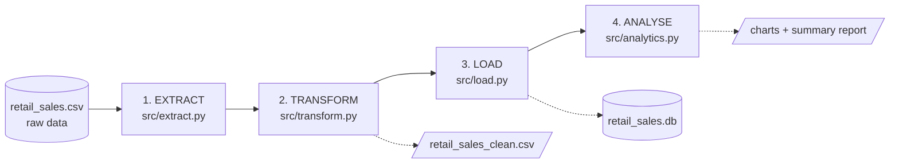
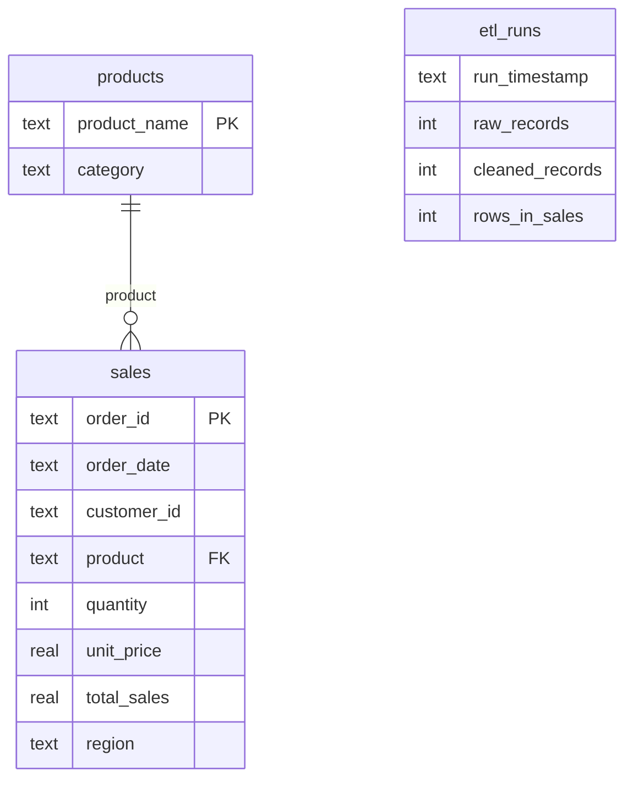
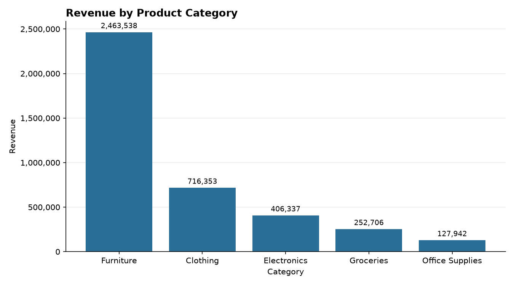
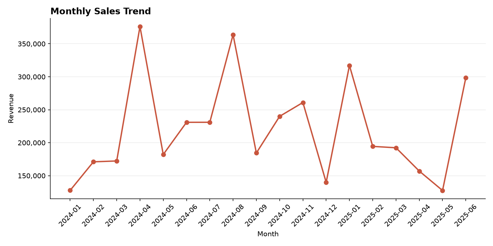
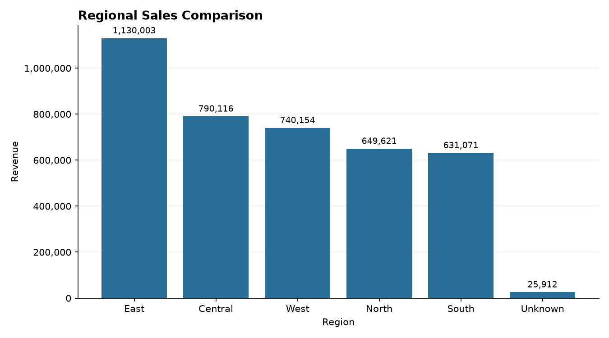
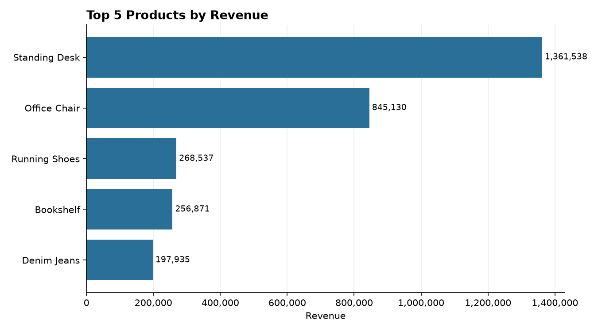

<div align="center">

# Retail Sales ETL and Analytics Pipeline

**Messy CSV in. Trusted SQL insights out. One command.**

[](https://www.python.org/)
[](https://pandas.pydata.org/)
[](https://www.sqlite.org/)
[](#testing)
[](LICENSE)

[Quick Start](#quick-start) &nbsp;|&nbsp; [Pipeline](#how-it-works) &nbsp;|&nbsp; [Results](#results) &nbsp;|&nbsp; [Database](#database-design) &nbsp;|&nbsp; [Testing](#testing) &nbsp;|&nbsp; [Roadmap](#roadmap)

</div>

<br>

A small, complete data engineering project. Raw retail sales data is **extracted** from CSV, **cleaned** with Pandas, **loaded** into SQLite and **analysed** with SQL and Matplotlib. It runs with a single command and is covered by automated Pytest tests.

> [!NOTE]
> `data/raw/retail_sales.csv` is a **synthetic dataset** (830 rows, fixed random seed) made by `scripts/generate_sample_data.py`. It is **not real company data**. Missing values, duplicates, mixed date formats, invalid entries and inconsistent spellings were injected on purpose to demonstrate the cleaning logic.

## At a Glance

<div align="center">

| 830 &rarr; 731 | 3,966,875.83 | 5,426.64 | 31 |
|:---:|:---:|:---:|:---:|
| rows before and after cleaning | total revenue | average order value | Pytest tests |

</div>

## Table of Contents

- [Quick Start](#quick-start)
- [The Problem and Objectives](#the-problem-and-objectives)
- [How It Works](#how-it-works)
- [Database Design](#database-design)
- [Results](#results)
- [Testing](#testing)
- [Project Structure](#project-structure)
- [Detailed Setup](#detailed-setup)
- [Roadmap](#roadmap)
- [Team](#team)

## Quick Start

```bash
git clone https://github.com/manasavadd/retail-sales-etl-pipeline.git
cd retail-sales-etl-pipeline

python -m venv .venv
pip install -r requirements.txt     # after activating .venv, see Detailed Setup

python -m src.pipeline              # run everything
```

Expected output:

```text
Records before cleaning: 830
Records after cleaning : 731
Rows in database       : 731
```

Run it again and the database stays at 731 rows, so there are no duplicates.

## The Problem and Objectives

Raw sales exports are rarely analysis-ready. Dates come in different formats, rows are duplicated, values are missing or invalid, and the same region or category is spelled several ways. Reporting on this data gives **wrong revenue numbers**.

This project builds a repeatable pipeline that turns messy sales records into a trustworthy relational dataset and business insights.

| | Objective |
|:---:|---|
| 1 | Ingest a raw CSV file and profile its quality problems |
| 2 | Clean it with documented, testable rules and log record counts before and after |
| 3 | Store it in SQLite with primary keys, constraints and no duplicate inserts on re-runs |
| 4 | Answer business questions with SQL: revenue, orders, category, region, month, top products |
| 5 | Produce charts and a summary report |
| 6 | Verify the behaviour with automated tests |

## How It Works



| Stage | File | What it does | Output |
|:---:|---|---|---|
| **1. Extract** | `src/extract.py` | Reads the CSV as text and validates the columns | Raw DataFrame |
| **2. Transform** | `src/transform.py` | Cleans, validates, standardises and computes `Total_Sales` | `data/processed/retail_sales_clean.csv` |
| **3. Load** | `src/load.py` | Creates the schema and upserts into SQLite | `database/retail_sales.db` |
| **4. Analyse** | `src/analytics.py` | Runs SQL queries, then draws charts and writes a report | `outputs/charts/*.png`, `outputs/summary_report.txt` |

`src/pipeline.py` orchestrates all four stages and writes `logs/pipeline.log`.

<details>
<summary><b>Cleaning rules (click to expand)</b></summary>

<br>

| Field | Rule |
|---|---|
| `Order_ID`, `Product` | Missing: row dropped, because it cannot be recovered |
| `Order_Date` | Parsed from 4 known formats (day-first for `dd/mm/yyyy`). Unparseable, before 2000 or in the future: dropped. Output is ISO `YYYY-MM-DD` |
| `Quantity` | Must be a whole number from 1 to 1000. Missing, text, zero, negative or absurd values: dropped |
| `Unit_Price` | Missing, text, zero or negative: imputed with the median valid price of the same product |
| `Category` / `Region` | Whitespace and case normalised, synonyms mapped (for example `Apparel` to `Clothing`, `N` to `North`). Missing category recovered from the product. Missing region becomes `Unknown` |
| `Customer_ID` | Missing becomes `UNKNOWN` |
| Duplicates | Exact duplicates removed, then repeated `Order_ID` removed (first kept) |
| `Total_Sales` | `Quantity x Unit_Price`, rounded to 2 decimals |

</details>

## Database Design



- `sales` has `CHECK` constraints and indexes.
- `etl_runs` stores one audit row per pipeline execution.
- **Idempotent loads:** rows are written with `INSERT ... ON CONFLICT(order_id) DO UPDATE` (upsert), so running the pipeline repeatedly never creates duplicate sales rows.

> [!WARNING]
> A row that disappears from the raw CSV is **not** deleted from the database. See the [Roadmap](#roadmap).

## Results

The summary report (`outputs/summary_report.txt`) for the shipped dataset:

```text
Total revenue          : 3,966,875.83
Total orders           : 731
Average order value    : 5,426.64
Top category           : Furniture (2,463,538.38)
Top region             : East (28.5% of revenue)
```

<table>
  <tr>
    <td align="center" width="50%"><b>Revenue by category</b><br></td>
    <td align="center" width="50%"><b>Monthly sales trend</b><br></td>
  </tr>
  <tr>
    <td align="center" width="50%"><b>Regional comparison</b><br></td>
    <td align="center" width="50%"><b>Top 5 products</b><br></td>
  </tr>
</table>

<details>
<summary><b>Sample SQL queries (click to expand)</b></summary>

<br>

All queries live in `sql/analysis_queries.sql`.

```sql
-- Total revenue
SELECT ROUND(SUM(total_sales), 2) AS total_revenue FROM sales;

-- Revenue by product category
SELECT p.category, ROUND(SUM(s.total_sales), 2) AS revenue
FROM sales s JOIN products p ON p.product_name = s.product
GROUP BY p.category ORDER BY revenue DESC;

-- Monthly sales trend
SELECT strftime('%Y-%m', order_date) AS month, ROUND(SUM(total_sales), 2) AS revenue
FROM sales GROUP BY month ORDER BY month;

-- Top five products by revenue
SELECT product, ROUND(SUM(total_sales), 2) AS revenue
FROM sales GROUP BY product ORDER BY revenue DESC LIMIT 5;
```

</details>

## Testing

```bash
python -m pytest -v
```

31 tests cover missing values, duplicate removal, invalid dates, quantities and prices, standardisation, `Total_Sales`, database loading, idempotent re-runs, SQL queries, chart creation and error handling.

## Project Structure

```text
retail-sales-etl-pipeline/
├── data/
│   ├── raw/retail_sales.csv          # synthetic raw data (input)
│   └── processed/                    # cleaned CSV (generated)
├── database/schema.sql               # tables, keys, indexes
├── scripts/generate_sample_data.py   # recreates the synthetic dataset
├── src/
│   ├── extract.py
│   ├── transform.py
│   ├── load.py
│   ├── analytics.py
│   └── pipeline.py                   # runs all four stages
├── sql/analysis_queries.sql          # named analytical queries
├── outputs/charts/                   # PNG charts
├── tests/
│   ├── test_transform.py
│   └── test_pipeline.py
├── logs/                             # pipeline.log (generated)
└── requirements.txt  .gitignore  .env.example  LICENSE  README.md
```

## Detailed Setup

<details>
<summary><b>Installation (click to expand)</b></summary>

<br>

Requires **Python 3.10 or newer** and Git.

```bash
git clone https://github.com/manasavadd/retail-sales-etl-pipeline.git
cd retail-sales-etl-pipeline

# create and activate a virtual environment
python -m venv .venv
# Windows (PowerShell):  .venv\Scripts\Activate.ps1
# Windows (cmd):         .venv\Scripts\activate.bat
# macOS / Linux:         source .venv/bin/activate

pip install -r requirements.txt
```

</details>

<details>
<summary><b>VS Code setup (click to expand)</b></summary>

<br>

1. Install VS Code and the **Python** extension (Microsoft).
2. `File > Open Folder...` and choose `retail-sales-etl-pipeline`.
3. Press `Ctrl+Shift+P`, choose **Python: Select Interpreter** and pick the one inside `.venv`.
4. Open a terminal with ``Ctrl+` `` (it activates `.venv` automatically).
5. Optional: install the **SQLite Viewer** extension to open `database/retail_sales.db` and run queries from `sql/analysis_queries.sql`.

</details>

### Commands

Always run from the project root:

| Command | What it does |
|---|---|
| `python -m src.pipeline` | Full pipeline |
| `python -m src.pipeline --skip-outputs` | ETL only, no charts or report |
| `python scripts/generate_sample_data.py` | Optional: regenerate the synthetic CSV |
| `python -m pytest -v` | Run the test suite |

## Roadmap

- [ ] Delete-and-reload or soft-delete mode, so rows removed from the source also leave the database
- [ ] Rejected-records file that stores each dropped row with its reason
- [ ] Incremental loading and scheduling (cron or Airflow)
- [ ] Data-quality checks with Great Expectations or Pandera
- [ ] Customer segmentation (RFM) and a dashboard (Streamlit or Power BI)
- [ ] PostgreSQL support and a GitHub Actions workflow that runs the tests on every push

## Team

| Name | Roll No |
|---|---|
| Manasa Vaddadi | 23311A05P7 |
| Ashish Paul Nittu | 23311A05M2 |
| Chitkul Lakshya | 23311A05Q4 |

CSE-D, SNIST

## License

MIT. See [LICENSE](LICENSE).
